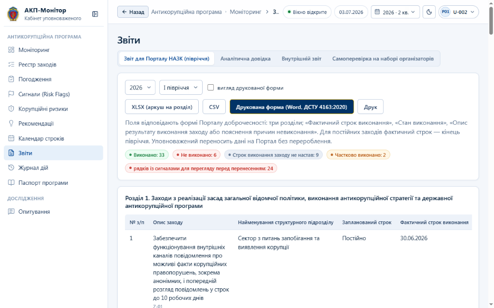
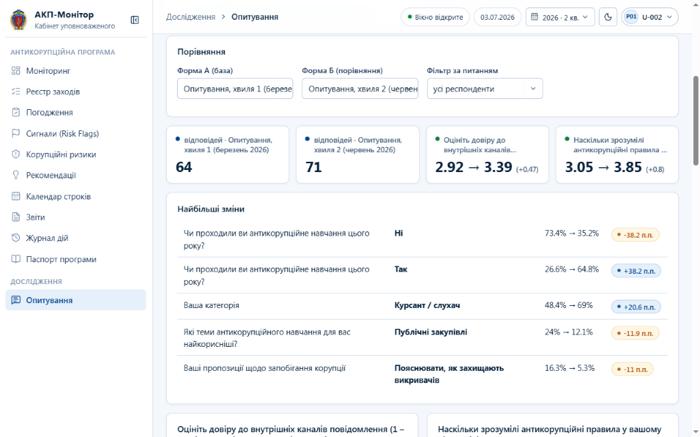

# АКП-Монітор

**Команда ХНУВС · Завдання 2. Цифрова система моніторингу виконання антикорупційної програми**  
IV Хакатон з питань виховання доброчесності та запобігання корупції (Building Integrity Hackathon · BITEC, 2026)

> Усі дані в системі та репозиторії вигадані (синтетичний набір організаторів). Профілі користувачів знеособлені (код, роль, підрозділ, посада — без ПІБ і персональних даних). Усі оцінки, сигнали та висновки з наслідками формуються виключно за відкритими детермінованими правилами ([`backend/monitor/rules.yaml`](backend/monitor/rules.yaml)) або посадовою особою (п. 4 Політики використання ШІ).

---

## Проблема і користувач

**Користувачі:** виконавці заходів у структурних підрозділах, координатор програми (уповноважений підрозділ з питань запобігання та виявлення корупції), керівник органу, фахівці Департаменту з питань запобігання та виявлення корупції МОУ та представники громадськості.

Сьогодні моніторинг антикорупційної програми ведеться у розрізнених таблицях і листах: уповноважена особа вручну збирає відповіді підрозділів, перевіряє їх і переносить на Портал доброчесності НАЗК. Така звітність фіксує лише формальне «виконано», але не показує, чи зменшився сам корупційний ризик. **АКП-Монітор** впроваджує принцип **«внесення даних один раз — багаторазове використання»**: виконавець за один крок подає статус, показник і підтвердження, а моніторинг, сигнали, управлінські рекомендації, аналітична довідка і звіт у структурі Порталу НАЗК формуються автоматично. Головний показник системи — **зміна індикатора стану корупційного ризику**, а не кількість закритих заходів.

---

## Доступ для журі та тестування системи

> [!IMPORTANT]
> **Вхід до системи здійснюється ВИКЛЮЧНО за персональним електронним ключем (`.key`) та паролем захисту.**  
> Класичну авторизацію лише за логіном і паролем повністю вимкнено з міркувань кібербезпеки. Приватні ключі шифруються паролем за стандартом **AES-256-GCM** і зберігаються виключно на боці користувача; сервер володіє лише відкритим ключем (Zero-Knowledge Architecture).

### 1. Завантаження тестових ключів (.key)
Для зручності членів журі всі готові тестові файли ключів для 19 користувачів зібрано в архіві:
**[Google Drive з тестовими ключами (.key) для журі](https://drive.google.com/drive/folders/1ALUfDx5LLqq7SiAKn8EBfIFlxYCtSMht?usp=drive_link)**

Пароль захисту для всіх згенерованих ключів: **`demo`**  
Повний реєстр облікових записів, ролей та підрозділів: [`docs/ACCOUNTS.txt`](docs/ACCOUNTS.txt).

### 2. Як увійти в кабінет (4 прості кроки)
1. Відкрийте сторінку входу **`https://akpmonitor.dev/login`** (або натисніть кнопку **«Кабінет»** у шапці [Публічного порталу](https://akpmonitor.dev/public)).
2. Перетягніть у вікно або оберіть потрібний файл ключа (наприклад, `akp_u-002.key`) — логін користувача та контрольний відбиток SHA-256 підставляться автоматично.
3. Введіть пароль захисту ключа: **`demo`**.
4. Натисніть **«Увійти за електронним ключем»**.

### 3. Рекомендовані облікові записи для перевірки журі
| Роль / Призначення | Логін | Файл ключа | Пароль | Що демонструє в системі |
|---|---|---|---|---|
| **Уповноважений (`KOORD`)** | `u-002` | `akp_u-002.key` | `demo` | Повний доступ: оперативний моніторинг виконання заходів, погодження статусів, аналіз ризик-сигналів, звіти НАЗК за Наказом № 410, порівняння опитувань |
| **Виконавець (`VYK`, підрозділ `P10`)** | `u-015` | `akp_u-015.key` | `demo` | Кабінет виконавця: лише власні заходи, внесення за 1 крок, завантаження доказів, автоперевірка `precheck` |
| **Керівник органу (`KER`)** | `u-004` | `akp_u-004.key` | `demo` | Стратегічні дашборди керівника, управлінські рекомендації без рейтингування підрозділів, загальний стан ризиків |
| **Технічний адміністратор (`ADMIN`)** | `u-001` | `akp_u-001.key` | `demo` | Управління електронними ключами (`/admin/keys`: випуск, перевипуск, відкликання), аудит SHA-256, звітні вікна |
| **Внутрішній аудитор (`AUDIT`)** | `u-005` | `akp_u-005.key` | `demo` | Аналітичні звіти, динамічні цифрові водяні знаки ІзОД/ДСК для запобігання витокам інформації |

*(При локальному розгортанні без доступу до інтернету тестові ключі можна згенерувати командою: `python manage.py generate_local_keys --output-dir local_keys`)*.

---

## Що робить рішення

- **Безпарольна автентифікація за файлом електронного ключа (.key):** криптографічний стандарт `AKP-KEY-V1` на базі асиметричних ключів **ECDSA P-256**, шифрування закритого ключа паролем через **PBKDF2** (100 000 ітерацій) та **AES-256-GCM**. Автентифікація за протоколом Challenge-Response у браузері через Web Crypto API з нульовим знанням сервера про закритий ключ і захистом від replay-атак через `FileBasedCache`.
- **Публічний портал моніторингу та верифікація звітів:** відкритий доступ для громадян і контролюючих органів без авторизації: ключові KPI, інтерактивні графіки з повними назвами розділів антикорупційної програми в дужках (`Розділ 1 (Назва)`, `Розділ 2 (Назва)`, `Розділ 3 (Назва)`), тултіпами, фільтрами та публічною сторінкою верифікації документів `/verify` із QR-кодами та адаптивною мобільною шапкою.
- **Електронний паспорт і реєстр програми:** 3 розділи Наказу НАЗК № 410, цілі, строки, відповідальні підрозділи та обовʼязкова привʼязка кожного заходу розділу 2 до корупційного ризику й індикатора його зменшення.
- **Кабінет виконавця з 5-денним квартальним вікном:** виконавець бачить лише заходи свого підрозділу, отримує підказку потрібних підтверджень і миттєву попередню перевірку (`precheck`) до відправлення координатору.
- **Автоматичні сигнали Risk Flags (11 правил `RF1–RF7e`):** виявлення прострочень, відсутності доказів, «формального закриття» (захід виконано, а ризик пройшов `< 10 %` шляху до цілі), скопійованих описів та підтверджень «заднім числом» — **29 із 29 навмисних кейсів ключа організаторів, 0 хибних спрацювань**.
- **Панелі без рейтингування та пояснювані рекомендації:** інтерактивний дашборд керівника й уповноваженого, карта підрозділів без некоректного рейтингування, автоматичні пропозиції управлінських рішень із призначенням відповідального підрозділу та строку.
- **Звітність для Порталу НАЗК та ДСТУ 4163:2020:** автоматичний піврічний звіт у точній структурі Порталу доброчесності (**50 із 50 рядків збігаються з еталоном організаторів**), експорт у `XLSX`, `CSV`, а також готові друковані форми `Word (.docx)` за ДСТУ 4163:2020 для програм з обмеженим доступом і аналітичних довідок.
- **Незмінність доказів і криптографічний журнал дій:** SHA-256 контрольна сума кожного завантаженого файлу (без права редагування чи видалення) та журнал дій із криптографічним ланцюжком хешів SHA-256 і блокуванням транзакцій `select_for_update` (захист від Race Condition).
- **Комплексна кібербезпека (OWASP Top 10:2025):** 
  - Захист від Brute-Force та перебору: Rate Limiting (10 запитів/хв з однієї IP/для логіна з поверненням HTTP 429) та протидія User Enumeration.
  - Захист від CSV/XLSX Formula Injection (OWASP CWE-1236): нейтралізація символів `=`, `+`, `-`, `@`, `\t`, `\r` одинарною лапкою.
  - Суворий білий список розширень, перевірка сигнатур Magic Bytes та жорсткий ліміт розміру доказу 20 МБ.
  - Детектор дублювання файлів за хешем SHA-256.
  - Захист інформації з обмеженим доступом (ІзОД/ДСК) із накладанням динамічних цифрових водяних знаків користувача.
  - $k$-анонімність ($k \ge 5$) та автоматичне знеособлення персональних даних в опитуваннях.
  - Захисні HTTP-заголовки CSP/HSTS, повне маскування внутрішніх стектрейсів у Caddy. Детально: [SECURITY.md](SECURITY.md).
- **Порівняння анонімних опитувань (додатково):** аналіз динаміки двох хвиль Google Форм (CSV) лише для уповноваженої особи з автоматичним відкиданням колонок e-mail і захистом малих груп (`< 5` відповідей).

| Панель моніторингу (уповноважений) | Звіт для Порталу НАЗК |
|---|---|
|  |  |
| **Кабінет виконавця (внесення за 1 крок)** | **Порівняння анонімних опитувань** |
|  |  |

---

## Демонстрація

- **Працюючий онлайн-стенд:** [https://akpmonitor.dev](https://akpmonitor.dev)
- **Публічний портал моніторингу:** [https://akpmonitor.dev/public](https://akpmonitor.dev/public)
- **Публічна перевірка звітів:** [https://akpmonitor.dev/verify](https://akpmonitor.dev/verify)
- **Відео демонстрації (до 3 хвилин):** `[Додайте посилання на YouTube (доступ «за посиланням») або Google Drive перед фіксацією документації]` *(сценарій ролика — у [`docs/demo-script.md`](docs/demo-script.md))*.
- **Інтерактивна документація REST API (OpenAPI / Swagger):** доступна за адресою `https://akpmonitor.dev/api/docs/` (або локально `http://localhost:8000/api/docs/`).

---

## Як запустити

Потрібно встановити заздалегідь: **Docker Desktop** (рекомендовано — 1 команда) або **Python 3.12+** і **Node.js 22+**.

### Варіант А. Docker + PostgreSQL (у 2 кроки)
```bash
git clone <URL-репозиторію> && cd akp-monitor
docker compose up --build
```
Відкрийте у браузері **`http://localhost:8000`** (міграції, імпорт синтетичного набору даних та демо-опитувань виконуються автоматично).

### Варіант Б. Локально без Docker (SQLite, у 4 кроки)
```bash
cd backend && pip install -r requirements.txt
python manage.py migrate && python manage.py import_dataset
python manage.py generate_local_keys --output-dir ../local_keys
cd ../frontend && npm install && npm run build
cd ../backend && python manage.py runserver
```
Відкрийте **`http://localhost:8000`**. Перевірка всіх 40 автотестів (сигнали = ключу, звіт = еталону, ролі, електронні ключі ECDSA P-256, цілісність журналу, OWASP безпека, ДСТУ 4163:2020):
```bash
cd backend && python manage.py test monitor
```

---

## Як влаштовано

```
React 19 (Vite, TS, Web Crypto API) ──REST/JSON──► Django 5 + DRF ──► PostgreSQL 16 / SQLite
                                                      │
                                                      ├── monitor/auth_keys.py   криптографічна перевірка ключів AKP-KEY-V1
                                                      ├── monitor/rules.yaml     відкриті правила сигналів, балів і рекомендацій
                                                      ├── monitor/rules.py       детерміноване аналітичне ядро (без ШІ)
                                                      ├── monitor/reports_docx.py експорт документів Word за ДСТУ 4163:2020
                                                      ├── monitor/selfcheck.py   автозвірка з ключем і еталоном організаторів
                                                      └── /api/docs/             OpenAPI-схема для інтеграції з ІС МОУ та НАЗК
```

- **Хто ухвалює висновки (п. 4 Політики ШІ):** система не викликає мовних чи статистичних моделей ШІ. Сигнали `RF1–RF7e`, бальна оцінка ризику невиконання (`0` — низький, `1–2` — середній, `≥ 3` — високий), статус заходу для Порталу НАЗК та чернетки рекомендацій обчислюються детермінованими функціями в [`backend/monitor/rules.py`](backend/monitor/rules.py) за параметрами з [`backend/monitor/rules.yaml`](backend/monitor/rules.yaml). Усі управлінські рішення з наслідками затверджує людина.
- **Робота в закритому контурі:** жодних зовнішніх хмарних сервісів чи CDN для роботи інтерфейсу; розгортається як автономний сервіс або як модуль наявної ІС через REST API.

---

## Документація

Усі матеріали, передбачені розділом «Очікуваний формат кінцевого продукту» Завдання 2, розміщені у [`docs/`](docs/) у форматі Markdown та продубльовані у Word за ДСТУ 4163:2020 ([`docs/word/`](docs/word/)):

- [`docs/ACCOUNTS.txt`](docs/ACCOUNTS.txt) — повний реєстр усіх 19 облікових записів системи, опис ролей, посилання на Google Drive з ключами.
- [SECURITY.md](SECURITY.md) — детальний опис архітектури кібербезпеки: автентифікація за ключем AKP-KEY-V1, криптографічний аудит, верифікація зліпків, захист ІзОД/ДСК, k-анонімність, захисні HTTP-заголовки.
- [`docs/ai.md`](docs/ai.md) — довідка щодо ролі допоміжних інструментів та використання ШІ (авторські рішення команди, повна автономність системи, відкинуті варіанти).
- [`docs/architecture.md`](docs/architecture.md) — архітектура системи, модель даних, потік «одноразового внесення» та механізми безпеки.
- [`docs/time-savings.md`](docs/time-savings.md) — розрахунок економії часу для виконавця, координатора та уповноваженої особи (`≈ 247 год/рік`).
- [`docs/integration.md`](docs/integration.md) — карта інтеграції з відомчими ІС (СЕД, кадри, закупівлі, аудит) та поетапне бачення обміну з ІС МОУ і Порталом НАЗК.
- [`docs/abuse-analysis.md`](docs/abuse-analysis.md) — аналіз 15 можливих сценаріїв зловживань і формального виконання та закладених у систему запобіжників.
- [`docs/demo-script.md`](docs/demo-script.md) — похвилинний сценарій 3-хвилинної відеодемонстрації повного циклу роботи із заходом.
- [`docs/word/`](docs/word/) — готові документи Word за ДСТУ 4163:2020, включно зі згенерованими системою зразками аналітичної довідки (`07_Analitychna_dovidka_zrazok.docx`) та звіту для НАЗК (`08_Zvit_NAZK_I_pivrichchia_2026_zrazok.docx`).

---

## Що використали

- **Відкриті дані та нормативна база:** синтетичний набір даних Завдання 2 від організаторів BITEC (`backend/data/dataset/`), структура звітності за Розʼясненням НАЗК № 3 і Методологією управління корупційними ризиками № 830/21, вимоги оформлення документів ДСТУ 4163:2020.
- **Відкриті бібліотеки (MIT / BSD / Apache-2.0):**
  - Backend: Python 3, Django 5, Django REST Framework, `drf-spectacular` (OpenAPI), `cryptography`, `PyYAML`, `openpyxl`, `python-docx`, `whitenoise`, `gunicorn`, `psycopg`.
  - Frontend: React 19, TypeScript, React Router 7, Recharts, `lucide-react`, Vite, Web Crypto API.
- **Графіка:** офіційний герб Харківського національного університету внутрішніх справ із Wikimedia Commons.
- **Допоміжні інструменти під час розробки:** Claude (Anthropic) та Gemini у середовищі Google Antigravity (використовувалися виключно як допоміжний довідковий ресурс для підказок і вичитки документації; вся архітектура, бізнес-логіка, детерміновані правила та код написані безпосередньо командою розробників, а робочий контур системи є на 100% автономним і не містить ШІ-моделей) — детально у [`docs/ai.md`](docs/ai.md).
- **Ліцензія проєкту:** [MIT License](LICENSE).
