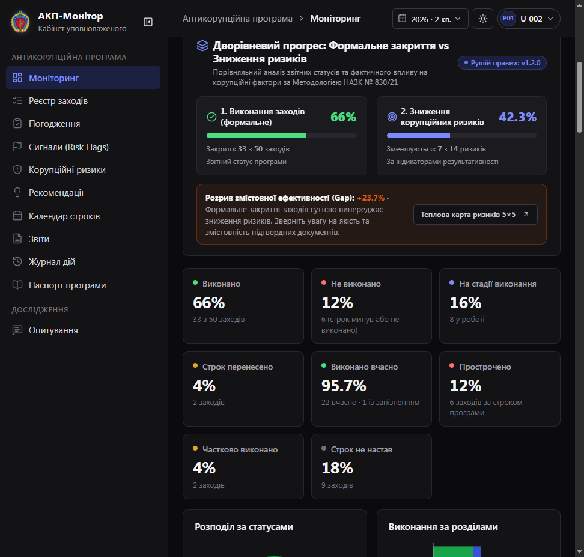

# АКП-Монітор

**Цифрова система моніторингу виконання антикорупційної програми** - рішення Завдання 2
IV Хакатону з питань виховання доброчесності та запобігання корупції (BITEC, 2026).

> Усі дані синтетичні (набір організаторів). Система не містить персональних даних, службової інформації
> чи інформації з обмеженим доступом. Висновки з наслідками формуються лише явними правилами
> ([`backend/monitor/rules.yaml`](backend/monitor/rules.yaml)) або людиною.

## Яку проблему розвʼязуємо

Сьогодні виконання програми ведеться в розрізнених таблицях. Уповноважена особа збирає відповіді
підрозділів, зводить їх вручну і переносить на Портал доброчесності. Звіт фіксує, що захід «виконано»,
але не показує, чи зменшився корупційний ризик.

АКП-Монітор робить так, щоб **виконавець вносив дані один раз**, а моніторинг, сигнали, панелі,
внутрішній звіт, аналітична довідка і звіт для Порталу НАЗК формувалися з них автоматично.
Головний показник - **зміна індикатора стану ризику**, а не кількість закритих заходів.

## Що вміє система

| Вимога завдання | Як реалізовано |
|---|---|
| 1. Електронний паспорт програми | «Паспорт програми»: структура, цілі, розділи, ризики, затвердження |
| 2. Звʼязок заходу з ризиком та індикатором | Кожен захід розділу 2 обовʼязково повʼязаний з ризиком; для ризику - індикатор стану з базовим, поточним і цільовим значенням |
| 3. Цифровий супровід виконання | Внесення статусу, фактичної дати, значення індикатора, опису і підтверджень за один крок; погодження координатором; коментарі |
| 4. Контроль строків і нагадування | Календар, нагадування за N днів, прострочення, внутрішні перенесення строку (програма не змінюється) |
| 5. Прогрес за показниками, підрозділами, напрямами, періодами | Панель моніторингу, розподіл за розділами, карта підрозділів, квартальні періоди |
| 6. Risk Flags | 11 правил RF1-RF7e; **29 з 29** навмисних кейсів ключа, 0 зайвих (див. «Самоперевірка») |
| 7. Панелі для різних рівнів | Кабінети уповноваженого, керівника, виконавця, аналітика, техадміністратора |
| 8. Звітність і дані для НАЗК | Звіт за півріччя у структурі Порталу (**50 з 50 рядків збігаються з еталоном**), XLSX/CSV, друкована форма; внутрішній звіт; аналітична довідка |
| 9. Журнал дій і незмінність матеріалів | Журнал із ланцюжком хешів SHA-256 (підробку видно); підтвердні матеріали не можна змінити чи видалити, лише додати |
| Управлінські рекомендації | Генеруються за явними правилами з поясненням підстав; людина приймає рішення, призначає відповідального і строк |
| Опитування (додатково) | Порівняння двох Google Форм (CSV) без збору пошти, з захистом малих груп |

## Ролі

| Роль | Хто | Доступ |
|---|---|---|
| Уповноважений (`KOORD`) | адміністратор програми | Усі розділи і зміни: план, погодження, перенесення строків, рекомендації, звіти; **лише він бачить «Опитування»** |
| Технічний адміністратор (`ADMIN`) | підтримка | Користувачі, звітні вікна, налаштування, перевірка цілісності; зміст програми не змінює |
| Керівник (`KER`) | керівник органу/підрозділу | Перегляд усієї інформації без права змін |
| Виконавець (`VYK`) | відповідальна особа підрозділу | Бачить і заповнює **лише заходи свого підрозділу**, і лише у відкрите звітне вікно |
| Аналітик (`ANAL`) | внутрішній аудит | Перегляд аналітики |

**Звітні вікна:** виконавці вносять дані 4 рази на рік, протягом 5 днів після завершення кварталу
(налаштовується). Поза вікном доступний лише перегляд. Техадміністратор може відкрити вікно позачергово.

## Швидкий старт

### Docker (рекомендовано; PostgreSQL)
```bash
docker compose up --build
# відкрити http://localhost:8000
```

### Локально (SQLite)
```bash
cd backend
pip install -r requirements.txt
python manage.py migrate
python manage.py import_dataset          # імпорт набору організаторів + демо-опитування
python manage.py runserver               # API на :8000

cd ../frontend
npm install
npm run dev                              # інтерфейс на http://localhost:5173
# або: npm run build - і Django сам віддаватиме інтерфейс на :8000
```

### Демо-входи (пароль `demo`)
| Логін | Роль |
|---|---|
| `u-002` | Уповноважений (координатор програми) |
| `u-004` | Керівник відомства |
| `u-015` | Виконавець · Управління майна (P10: два прострочені заходи) |
| `u-010` | Виконавець · Управління МТЗ (P05) |
| `u-001` | Технічний адміністратор |
| `u-005` | Аналітик |

Робоча (демо) дата за замовчуванням - **03.07.2026**: вікно внесення за ІІ квартал відкрите.
Змінити її може техадміністратор у «Налаштування і стан системи».

### Тести
```bash
cd backend && python manage.py test monitor
```
Тести (14) перевіряють: сигнали = ключу організаторів, звіт = еталону, ролі й доступ, закриття вікна,
виявлення підробки журналу, незмінність підтверджень, відкидання колонок з поштою в опитуваннях,
завантаження всіх експортів (XLSX, CSV, Word, Markdown) і поля/шрифт Word-документів за ДСТУ 4163:2020.

## Архітектура коротко

```
React (Vite, TS) ──REST/JSON──► Django + DRF ──► PostgreSQL / SQLite
                                   │
                                   ├── rules.yaml   явні правила сигналів, ризику, рекомендацій
                                   ├── rules.py     детерміноване аналітичне ядро
                                   └── /api/docs    OpenAPI для інтеграції з ІС МОУ та НАЗК
```
Детально: [docs/architecture.md](docs/architecture.md).

## Документи для подання

Word-версії оформлено за ДСТУ 4163:2020 (А4; поля 30/10/20/20 мм; Times New Roman 14 пт, у таблицях 10-12 пт;
абзацний відступ 10 мм; нумерація сторінок з другої посередині верхнього поля). Лежать у [`docs/word/`](docs/word/);
перегенерувати після змін у Markdown: `python manage.py build_docs`.

| Документ | Word (ДСТУ 4163:2020) | Джерело |
|---|---|---|
| Архітектура | `docs/word/01_Arkhitektura.docx` | [architecture.md](docs/architecture.md) |
| Розрахунок економії часу | `docs/word/02_Ekonomiia_chasu.docx` | [time-savings.md](docs/time-savings.md) |
| Карта і бачення інтеграції з ІС МОУ та НАЗК | `docs/word/03_Karta_intehratsii.docx` | [integration.md](docs/integration.md) |
| Аналіз можливих зловживань і запобіжників | `docs/word/04_Analiz_zlovzhyvan.docx` | [abuse-analysis.md](docs/abuse-analysis.md) |
| Як ми використали ШІ | `docs/word/05_Yak_my_vykorystaly_SHI.docx` | [ai-note.md](docs/ai-note.md) |
| Сценарій демо-відео | `docs/word/06_Stsenarii_demo.docx` | [demo-script.md](docs/demo-script.md) |
| Зразок аналітичної довідки (згенерований системою) | `docs/word/07_Analitychna_dovidka_zrazok.docx` | - |
| Зразок друкованої форми звіту для НАЗК | `docs/word/08_Zvit_NAZK_I_pivrichchia_2026_zrazok.docx` | - |

Система сама формує ці документи у Word: «Звіти» → «Друкована форма (Word, ДСТУ 4163:2020)» і «Аналітична довідка» →
«Завантажити Word». Друк із браузера також використовує поля й шрифт за ДСТУ.

## Відкриті питання (з README набору)

- Фактичний строк для невиконаного заходу: поле лишаємо порожнім, як в еталоні; варто уточнити у фахівця.
- Назва статусу: використано «Строк виконання заходу не настав» (як у спадному списку Порталу).
- Друкована форма: перемикач «інформація з обмеженим доступом» у паспорті програми + кнопка «Друкована форма» у звітах.

## Знімки екрана

| Моніторинг (уповноважений) | Опитування |
|---|---|
|  |  |
| **Захід у кабінеті виконавця** | **Звіт для Порталу НАЗК** |
|  |  |

Дизайн наближено до сайту ХНУВС (темно-синій і золотий). Кольори задані змінними в
`frontend/src/index.css` - їх легко підлаштувати під брендбук.
