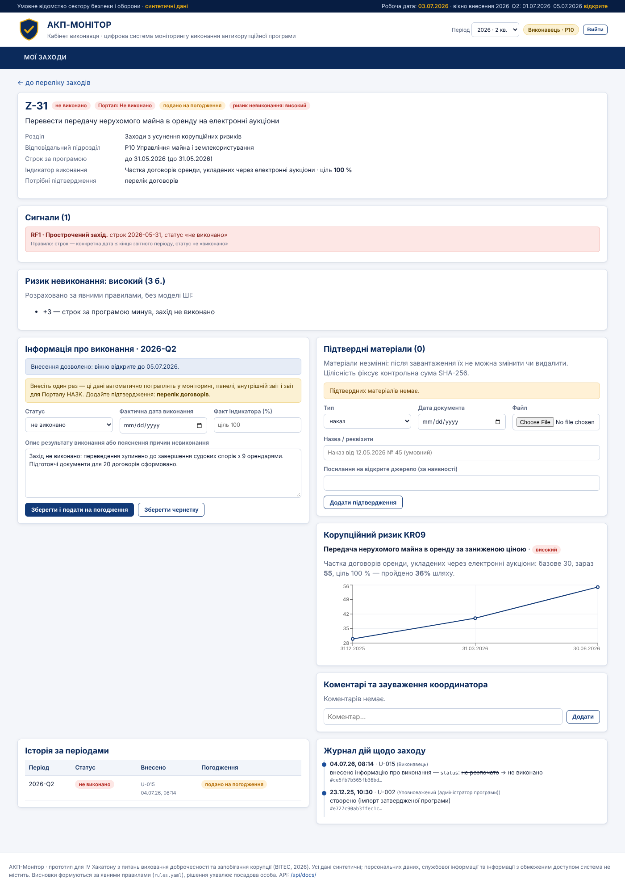

# АКП-Монітор

**Команда ХНУВС · Завдання 2. Цифрова система моніторингу виконання антикорупційної програми**  
IV Хакатон з питань виховання доброчесності та запобігання корупції (Building Integrity Hackathon · BITEC, 2026)

> Усі дані в системі та репозиторії вигадані (синтетичний набір організаторів). Профілі користувачів знеособлені (код, роль, підрозділ, посада — без ПІБ і персональних даних). Усі оцінки, сигнали та висновки з наслідками формуються виключно за відкритими детермінованими правилами ([`backend/monitor/rules.yaml`](backend/monitor/rules.yaml)) або посадовою особою (п. 4 Політики використання ШІ).

---

## Проблема і користувач

**Користувачі:** виконавці заходів у структурних підрозділах, координатор програми (уповноважений підрозділ з питань запобігання та виявлення корупції), керівник органу та фахівці Департаменту з питань запобігання та виявлення корупції МОУ.

Сьогодні моніторинг антикорупційної програми ведеться у розрізнених таблицях і листах: уповноважена особа вручну збирає відповіді підрозділів, перевіряє їх і переносить на Портал доброчесності НАЗК. Така звітність фіксує лише формальне «виконано», але не показує, чи зменшився сам корупційний ризик. **АКП-Монітор** впроваджує принцип **«внесення даних один раз — багаторазове використання»**: виконавець за один крок подає статус, показник і підтвердження, а моніторинг, сигнали, управлінські рекомендації, аналітична довідка і звіт у структурі Порталу НАЗК формуються автоматично. Головний показник системи — **зміна індикатора стану корупційного ризику**, а не кількість закритих заходів.

---

## Що робить рішення

- **Електронний паспорт і реєстр програми:** 3 розділи Порталу НАЗК, цілі, строки, відповідальні підрозділи та обовʼязкова привʼязка кожного заходу розділу 2 до корупційного ризику й індикатора його зменшення.
- **Кабінет виконавця з 5-денним квартальним вікном:** виконавець бачить лише заходи свого підрозділу, отримує підказку потрібних підтверджень і миттєву попередню перевірку (`precheck`) до відправлення координатору.
- **Автоматичні сигнали Risk Flags (11 правил `RF1–RF7e`):** виявлення прострочень, відсутності доказів, «формального закриття» (захід виконано, а ризик пройшов `< 10 %` шляху до цілі), скопійованих описів та підтверджень «заднім числом» — **29 із 29 навмисних кейсів ключа організаторів, 0 хибних спрацювань**.
- **Панелі без рейтингування та пояснювані рекомендації:** інтерактивний дашборд керівника й уповноваженого, карта підрозділів без рейтингування, автоматичні пропозиції управлінських рішень із призначенням відповідального підрозділу та строку.
- **Звітність для Порталу НАЗК та ДСТУ 4163:2020:** автоматичний піврічний звіт у точній структурі Порталу доброчесності (**50 із 50 рядків збігаються з еталоном організаторів**), експорт у `XLSX`, `CSV`, а також готові друковані форми `Word (.docx)` за ДСТУ 4163:2020 для програм з обмеженим доступом і аналітичних довідок.
- **Незмінність доказів і криптографічний журнал дій:** SHA-256 контрольна сума кожного завантаженого файлу (без права редагування чи видалення) та журнал дій із ланцюжком хешів SHA-256, де будь-яке втручання миттєво виявляється.
- **Порівняння анонімних опитувань (додатково):** аналіз динаміки двох хвиль Google Форм (CSV) лише для уповноваженої особи з автоматичним відкиданням колонок e-mail і захистом малих груп (`< 5` відповідей).

| Панель моніторингу (уповноважений) | Звіт для Порталу НАЗК |
|---|---|
|  |  |
| **Кабінет виконавця (внесення за 1 крок)** | **Порівняння анонімних опитувань** |
|  |  |

---

## Демонстрація

- **Відео демонстрації (до 3 хвилин):** `[Додайте посилання на YouTube (доступ «за посиланням») або Google Drive перед фіксацією документації]` *(сценарій ролика — у [`docs/demo-script.md`](docs/demo-script.md))*.
- **Інтерактивна документація REST API (OpenAPI / Swagger):** відкривається після запуску за адресою `http://localhost:8000/api/docs/`.

---

## Як запустити

Потрібно встановити заздалегідь: **Docker Desktop** (рекомендовано — 1 команда) або **Python 3.12+** і **Node.js 22+**.

### Варіант А. Docker + PostgreSQL (у 2 кроки)
```bash
git clone <URL-репозиторію> && cd akp-monitor
docker compose up --build
```
Відкрийте у браузері **`http://localhost:8000`** (міграції, імпорт синтетичного набору даних та демо-опитувань виконуються автоматично).

### Варіант Б. Локально без Docker (SQLite, у 4 кроки)
```bash
cd backend && pip install -r requirements.txt
python manage.py migrate && python manage.py import_dataset
cd ../frontend && npm install && npm run build
cd ../backend && python manage.py runserver
```
Відкрийте **`http://localhost:8000`**. Перевірка всіх 18 автотестів (сигнали = ключу, звіт = еталону, ролі, цілісність журналу, безпека, ДСТУ 4163:2020):
```bash
cd backend && python manage.py test monitor
```

### Демо-входи (пароль для всіх: `demo`, робоча дата: `03.07.2026` — відкрите вікно Q2)
Повний перелік усіх 19 облікових записів системи наведено у файлі [ACCOUNTS.txt](ACCOUNTS.txt).

| Логін | Роль | Що демонструє |
|---|---|---|
| `u-002` | Уповноважений (`KOORD`) | Повний доступ: моніторинг, погодження, перенесення строків, рекомендації, звіти НАЗК, опитування |
| `u-004` | Керівник органу (`KER`) | Аналітичні панелі, ризики та звіти в режимі перегляду |
| `u-015` | Виконавець (`VYK`, підрозділ `P10`) | Кабінет виконавця: лише власні заходи, внесення за 1 крок і попередня перевірка сигналів |
| `u-001` | Техадміністратор (`ADMIN`) | Користувачі, звітні вікна, налаштування, перевірка цілісності SHA-256 (зміст програми не змінює) |
| `u-005` | Аналітик (`ANAL`) | Аналітика ризиків, сигналів і звітів без права редагування |

---

## Як влаштовано

```
React 19 (Vite, TS, адаптивний UI) ──REST/JSON──► Django 5 + DRF ──► PostgreSQL 16 / SQLite
                                                     │
                                                     ├── monitor/rules.yaml     відкриті правила сигналів, балів і рекомендацій
                                                     ├── monitor/rules.py       детерміноване аналітичне ядро (без ШІ)
                                                     ├── monitor/reports_docx.py експорт документів Word за ДСТУ 4163:2020
                                                     ├── monitor/selfcheck.py   автозвірка з ключем і еталоном організаторів
                                                     └── /api/docs/             OpenAPI-схема для інтеграції з ІС МОУ та НАЗК
```

- **Хто ухвалює висновки (п. 4 Політики ШІ):** система не викликає мовних чи статистичних моделей ШІ. Сигнали `RF1–RF7e`, бальна оцінка ризику невиконання (`0` — низький, `1–2` — середній, `≥ 3` — високий), статус заходу для Порталу НАЗК та чернетки рекомендацій обчислюються детермінованими функціями в [`backend/monitor/rules.py`](backend/monitor/rules.py) за параметрами з [`backend/monitor/rules.yaml`](backend/monitor/rules.yaml). Усі управлінські рішення з наслідками затверджує людина.
- **Робота в закритому контурі:** жодних зовнішніх хмарних сервісів чи CDN для роботи інтерфейсу; розгортається як автономний сервіс або як модуль наявної ІС через REST API.

---

## Документація

Усі матеріали, передбачені розділом «Очікуваний формат кінцевого продукту» Завдання 2, розміщені у [`docs/`](docs/) у форматі Markdown та продубльовані у Word за ДСТУ 4163:2020 ([`docs/word/`](docs/word/)):

- [`docs/ai.md`](docs/ai.md) — записка «Як ми використали ШІ» (інструменти, рішення команди, відкинуті варіанти).
- [`docs/architecture.md`](docs/architecture.md) — архітектура системи, модель даних, потік «одноразового внесення» та механізми безпеки.
- [`docs/time-savings.md`](docs/time-savings.md) — розрахунок економії часу для виконавця, координатора та уповноваженої особи (`≈ 247 год/рік`).
- [`docs/integration.md`](docs/integration.md) — карта інтеграції з відомчими ІС (СЕД, кадри, закупівлі, аудит) та поетапне бачення обміну з ІС МОУ і Порталом НАЗК.
- [`docs/abuse-analysis.md`](docs/abuse-analysis.md) — аналіз 15 можливих сценаріїв зловживань і формального виконання та закладених у систему запобіжників.
- [`docs/demo-script.md`](docs/demo-script.md) — похвилинний сценарій 3-хвилинної відеодемонстрації повного циклу роботи із заходом.
- [`docs/word/`](docs/word/) — готові документи Word за ДСТУ 4163:2020, включно зі згенерованими системою зразками аналітичної довідки (`07_Analitychna_dovidka_zrazok.docx`) та звіту для НАЗК (`08_Zvit_NAZK_I_pivrichchia_2026_zrazok.docx`).

---

## Що використали

- **Відкриті дані та нормативна база:** синтетичний набір даних Завдання 2 від організаторів BITEC (`backend/data/dataset/`), структура звітності за Розʼясненням НАЗК № 3 і Методологією управління корупційними ризиками № 830/21, вимоги оформлення документів ДСТУ 4163:2020.
- **Відкриті бібліотеки (MIT / BSD / Apache-2.0):**
  - Backend: Python 3, Django 5, Django REST Framework, `drf-spectacular` (OpenAPI), `PyYAML`, `openpyxl`, `python-docx`, `whitenoise`, `gunicorn`, `psycopg`.
  - Frontend: React 19, TypeScript, React Router 7, Recharts, `lucide-react`, Vite.
- **Графіка:** офіційний герб Харківського національного університету внутрішніх справ із Wikimedia Commons.
- **Інструменти ШІ під час розробки:** Claude (Anthropic) та Gemini у середовищі Google Antigravity — детально описано в [`docs/ai.md`](docs/ai.md).
- **Ліцензія проєкту:** [MIT License](LICENSE).
